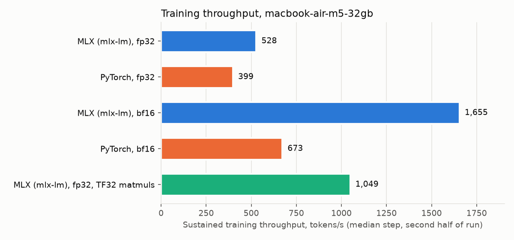
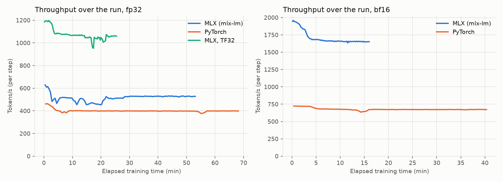

# MLX vs PyTorch MPS: full-weight training on Apple Silicon

An apples-to-apples comparison of **full-weight continued pretraining (CPT)** of the same model with
**MLX (mlx-lm)** and **PyTorch on MPS**, on the same Mac. The main question is which one trains faster.
Model quality is a sanity check: both should learn the same amount. It also measures what it costs to
take a PyTorch-trained model into MLX for inference.

- **Model:** [Qwen3-0.6B-Base](https://huggingface.co/Qwen/Qwen3-0.6B-Base), all 0.6B parameters trained (no LoRA)
- **Data:** full-text arXiv papers ([Common Pile `arxiv_papers_filtered`](https://huggingface.co/datasets/common-pile/arxiv_papers_filtered), one shard)
- **Machine:** MacBook Air, Apple M5 (10-core GPU), 32 GB unified memory, macOS 27.0.1. It's fanless, so it
  throttles under sustained load (see item 8 below).

## Results

**On the M5 MacBook Air, MLX trains 1.3× faster than PyTorch MPS in fp32 and 2.5× faster in bf16. Both
learn exactly the same amount.** With MLX's default fp32 settings (TF32 matmuls), it's 2.6× faster than
PyTorch fp32, at no measurable cost in quality.

Each run is 100 optimizer steps × 16,384 tokens (1.6M tokens), micro-batch 1. Every table and figure:
[runs/macbook-air-m5-32gb/REPORT.md](runs/macbook-air-m5-32gb/REPORT.md). Other machines:
[runs/COMPARISON.md](runs/COMPARISON.md).

| | MLX | PyTorch MPS | MLX / PyTorch |
|---|---|---|---|
| **fp32**, sustained tokens/s | 528 | 399 | **1.32×** |
| **bf16**, sustained tokens/s | 1,655 | 673 | **2.46×** |
| fp32 with TF32 matmuls (MLX's default on M5), tokens/s | 1,049 | (no TF32 on MPS) | 2.63× vs PyTorch fp32 |
| Wall time for 1.6M tokens, fp32 / bf16 / TF32 | 53 / 16 / 25 min | 68 / 40 min / – | |
| Peak memory, fp32 / bf16 (OS footprint) | 16.8 / 10.1 GB | 19.8 / 14.0 GB | MLX uses 15–28% less |
| Final training loss, fp32 / bf16 | 1.7363 / 1.7535 | 1.7364 / 1.7532 | per-step Δ ≤ 0.001 |
| arXiv held-out perplexity (base: 5.505), fp32 / bf16 | 5.182 / 5.253 | 5.181 / 5.252 | same |
| wikitext perplexity (base: 14.129), fp32 / bf16 | 14.814 / 14.299 | 14.795 / 14.304 | same |



What else the runs show:

- **The quality sanity check passes.** Loss curves overlap step for step (largest per-step difference
  0.0009 in fp32, 0.0010 in bf16), and held-out perplexity matches to 3 significant figures. Training on arXiv
  cut arXiv perplexity by 6% (5.505 → 5.18) and cost some general-text perplexity on wikitext
  (14.13 → 14.8), which is normal for continued pretraining.
- **TF32 is a good default on M5.** MLX's TF32 run reached the same loss (1.7362 vs 1.7363) and perplexity
  (5.181 vs 5.182) as true fp32, in half the time.
- **Pure bf16 learned less, as predicted** (arXiv perplexity 5.25 vs 5.18). At LR 2e-5, many weight updates
  are smaller than bf16 can represent and round away. It also forgot less, for the same reason.
- **Throttling costs about 13–14% on the Air** for every run except PyTorch bf16 (7%). All runs sat at
  "heavy" thermal pressure for 83–96% of steps. Measured on its first few steps with a cool chip, MLX's bf16
  lead would be about 2.7× instead of 2.5×. The fp32 lead is 1.33× either way. A MacBook Pro (with a fan) run
  will show this directly.
- **Converting the PyTorch-trained model to MLX takes about 3 seconds:** save 0.9 s, `mlx_lm.convert`
  1.9 s, load 0.35 s. The converted model gives the same fp32 loss as PyTorch (2.2832 vs 2.2832) on held-out
  text.



### Where the time goes (M5, `scripts/diag_step_phases.py`)

Seconds per 1024-token micro-batch, synchronizing between phases. "Optimizer" runs once per 16 micro-batches.

| | forward | forward + backward | optimizer |
|---|---|---|---|
| MLX fp32 | 0.76 | 1.99 | 0.67 |
| PyTorch MPS fp32, SDPA attention (HF default) | 0.59 | 2.71 | 0.22 |
| PyTorch MPS fp32, eager attention | 0.86 | 3.11 | 0.41 |
| MLX bf16 | 0.18 | 0.71 | 0.32 |
| PyTorch MPS bf16, SDPA attention (HF default) | 0.28 | 1.95 | 0.21 |
| PyTorch MPS bf16, eager attention | 0.52 | 1.68 | 0.22 |

PyTorch MPS has the faster forward pass in fp32 and the faster optimizer step in both precisions. The gap
is in the backward pass: about 1.7× slower than MLX in fp32 and about 3× slower in bf16. In bf16, SDPA's
backward on MPS is slow enough that eager attention is faster overall. The training runs keep HF's default
(SDPA). Eager would make PyTorch bf16 roughly 15% faster, which doesn't change the conclusion.

## What "apples to apples" means here

Everything that isn't the framework is held identical. Each framework still runs the model its normal
way, because that difference is what's being measured.

| Held identical | Allowed to differ (what's being measured) |
|---|---|
| Model and starting weights | Model code: mlx-lm's Qwen3 vs Hugging Face transformers' Qwen3 |
| Token stream: tokenized once, packed into 1024-token rows, same order (seed 0) | Kernels: MLX fused attention/RMSNorm/RoPE + `mx.compile` vs PyTorch eager + SDPA |
| Tokens per step (16,384), number of steps, LR schedule (computed by hand in both) | Optimizer implementation: MLX compiled update vs PyTorch fused AdamW |
| AdamW: β=(0.9, 0.95), eps 1e-8, weight decay 0.1 on all params, bias correction on | Memory management (each framework's allocator) |
| Grad clipping 1.0, fp32 loss, grad accumulation, no grad checkpointing, no dropout | |
| Precision: weights, grads and optimizer state all fp32, or all bf16 | |
| Runs one at a time, alternating frameworks, 60 s cooldown, plugged in | |

Before any long run, `scripts/parity.py` checks that the two implementations compute the same function.
On the untrained model in fp32, with two held-out sequences:

| Check | MLX vs PyTorch |
|---|---|
| Loss | differ by 4.8e-7 (2.352563 vs 2.352563) |
| Global gradient norm | relative difference 1.5e-6 |
| Per-parameter gradients | median relative difference 3.4e-4 (worst 8.5e-3, a layernorm weight) |
| Logits | mean abs difference 7.9e-6, max 3.7e-4 (max logit 34) |
| Next-token argmax | identical at 100% of positions |

## Things that silently break the comparison

These all came up while building this. Each one would have skewed the result without any error.

1. **On M5, MLX runs fp32 matmuls as TF32 by default.** On a 4096×1024×3072 matmul, MLX on the GPU had
   relative error 7.7e-4 (between fp16 and bf16), against 5.7e-7 for numpy, MLX on the CPU and PyTorch MPS.
   That makes it about 2.5× faster (7.6–9.1 vs 3.5 TFLOPS). PyTorch MPS has no TF32 mode;
   `torch.set_float32_matmul_precision` has no effect on MPS. This made the first parity check fail.
   The fp32 comparison sets `MLX_ENABLE_TF32=0`. One extra run (`mlx-fp32-tf32`) measures MLX's default.
2. **mlx-lm's trainer clears MLX's buffer cache every iteration** (`clear_cache_threshold=0` is the default).
   A hand-written MLX loop that doesn't do this reached a 25–26 GB footprint (against 20 GB of live buffers)
   and pushed the machine into swap. `train_mlx.py` matches mlx-lm's default.
3. **MLX's `AdamW` defaults to `bias_correction=False`.** PyTorch always applies bias correction. With it
   turned on, MLX's update formula is the same as PyTorch's: decoupled weight decay first, step count
   incremented before the update.
4. **Hugging Face builds a KV cache during training forward passes** unless you pass `use_cache=False`.
5. **Pure bf16 swallows small updates.** At a CPT-typical LR (2e-5), most Adam updates are smaller than
   bf16's resolution near typical weight magnitudes, so they round away. `(1 - lr·wd)` also rounds to 1, so
   weight decay is a no-op. This hits both frameworks equally, so the speed comparison still holds, but expect
   the bf16 runs to learn less than fp32. Storage dtypes match exactly. Internal op precision can differ:
   PyTorch's fused AdamW does its arithmetic in fp32 before rounding back.
6. **The frameworks' memory counters aren't comparable.** `mx.get_peak_memory()` is a true peak of live
   buffers. PyTorch MPS has no peak API, and `driver_allocated_memory()` includes its cache. The comparable
   number is the process's physical footprint as macOS accounts it (`proc_pid_rusage`,
   `ri_lifetime_max_phys_footprint`), which covers CPU and unified GPU memory alike.
7. **Timing lazy and async execution.** MLX is lazy: each step `mx.eval`s parameters and optimizer state.
   MPS is async: each step ends with `torch.mps.synchronize()`. The first 20 steps (compilation, shader
   caching) are excluded from throughput.
8. **Thermal throttling on a fanless Mac.** Within minutes of sustained GPU load, macOS thermal pressure
   reaches "heavy" (`notifyutil -g com.apple.system.thermalpressurelevel` returns 2). The same MLX fp32 step
   takes 25.6 s on a cool chip, 31 s once throttled, and about 40 s in a run that starts on a chip still hot
   from the previous one. In the 3-step calibration probes, MLX ran first on a cool chip and PyTorch ran later
   on a hot one, which made MLX look about 1.6× faster in fp32. The real figure is 1.3×. So `run_all.sh` waits for thermal pressure to return to nominal (plus 2 minutes) before every
   run. Each step logs its thermal level, and the headline number is **sustained** throughput: the median step
   over the second half of a run, at the thermal steady state.

## Setup

Requires [uv](https://docs.astral.sh/uv/). `requirements-macos.txt` is the exact environment that produced
the M5 results.

```bash
uv venv --python 3.13 .venv
uv pip install --python .venv/bin/python -r requirements-macos.txt
.venv/bin/python scripts/download.py               # model + data at pinned revisions (~1.4 GB)
.venv/bin/python -I scripts/prepare_data.py        # tokenize + pack: 24M train / 525k arXiv val / 298k wikitext tokens
```

`data/meta.json` records a sha256 of each token array. Matching values on two machines mean both trained
on identical tokens.

## Reproduce

Each machine writes to `runs/<machine>/`, e.g. `runs/macbook-air-m5-32gb/`. Set `BENCH_MACHINE` to override the
auto-detected name.

```bash
.venv/bin/python scripts/matmul_check.py           # precision + TFLOPS per framework/dtype (catches TF32 defaults)
.venv/bin/python scripts/parity.py model           # fp32 forward/backward agreement
.venv/bin/python scripts/probe.py                  # memory + speed per (setup, micro-batch)
.venv/bin/python scripts/diag_step_phases.py       # time split: forward / backward / optimizer

# Everything else, one job at a time (~6 h on the M5 Air, including cooldowns): 5 training runs, conversion,
# perplexity, report.
# Arguments: fp32 micro-batch, bf16 micro-batch, optimizer steps per run. The M5 results used:
caffeinate -is scripts/run_all.sh 1 1 100
tail -f runs/macbook-air-m5-32gb/logs/run_all.log

# Optional: cold-load timing (flushes the file cache before each load; asks for your password)
.venv/bin/python scripts/convert.py cold && .venv/bin/python scripts/report.py
```

Individual pieces:

```bash
.venv/bin/python scripts/train_mlx.py   --dtype float32 --micro-batch 1 --total-steps 100 --save
.venv/bin/python scripts/train_torch.py --dtype float32 --micro-batch 1 --total-steps 100 --save
.venv/bin/python scripts/train_mlx.py   --dtype float32 --tf32 ...  # MLX's default fp32 behaviour on M5
.venv/bin/python scripts/parity.py runs mlx-fp32 torch-fp32         # per-step loss / grad-norm agreement
.venv/bin/python scripts/convert.py                                 # -> checkpoints/<run>-mlx (bf16), timed
.venv/bin/python scripts/eval_ppl.py                                # perplexity, all models in mlx-lm
.venv/bin/python scripts/report.py   # -> runs/<machine>/REPORT.md + figures/, and runs/COMPARISON.md
```

## Running on Linux + NVIDIA (PyTorch only)

The same scripts run PyTorch on CUDA. `run_all.sh` detects that MLX isn't installed, runs only the
PyTorch trainings (fp32, bf16, and fp32 with TF32, which CUDA supports), and skips the MLX conversion and
perplexity steps. `report.py` then writes `runs/COMPARISON.md`, a table of throughput and final loss for
every run on every machine.

```bash
uv venv --python 3.13 .venv
# Pick the CUDA wheel index for your driver from pytorch.org (RTX 50-series needs a CUDA 12.8+ build)
uv pip install --python .venv/bin/python torch --index-url https://download.pytorch.org/whl/<cuXXX>
uv pip install --python .venv/bin/python transformers==5.21.0 huggingface_hub numpy pyarrow matplotlib
uv pip freeze --python .venv/bin/python > requirements-cuda.txt
.venv/bin/python scripts/download.py && .venv/bin/python -I scripts/prepare_data.py
jq .sha256 data/meta.json                    # must match the M5 checksums below

.venv/bin/python scripts/matmul_check.py
.venv/bin/python scripts/probe.py            # pick the largest micro-batch that fits; 1 matches the M5 runs
systemd-inhibit --what=sleep:idle scripts/run_all.sh 1 1 100
```

transformers is pinned to the M5 run's version so the model code is the same. For a laptop GPU, record the power mode. The GPU power limit depends on the laptop and is logged in
each run's `config.json` along with the driver and CUDA versions.

Data checksums from the M5 (`data/` isn't committed):

| Array | sha256 |
|---|---|
| train | `49d77310cefeb9001189695540455a2c87359015403baeb06040b0db30006ebf` |
| val_arxiv | `6b319453f46ba0b9ea117d7c2bfa95b1dfea9e72f21c4e5bf899d7569d223eba` |
| val_wikitext | `fa1829bda24d0f07f43b8645c56e50c367206a016f53970fe12386e20187ecd3` |

## Compare model outputs

All models, including the PyTorch-trained ones after conversion, run in mlx-lm. They are base models, so
give them text to continue rather than questions. `--temp 0` makes decoding greedy and repeatable.
`--ignore-chat-template` stops mlx-lm from wrapping the prompt in chat formatting.

```bash
P="In this paper, we propose a novel method for"
for m in models/Qwen3-0.6B-Base checkpoints/mlx-fp32-mlx checkpoints/torch-fp32-mlx; do
  echo "=== $m"
  .venv/bin/mlx_lm.generate --model "$m" --prompt "$P" --max-tokens 200 --temp 0 --ignore-chat-template
done
```

Or run every prompt in `prompts.txt` side by side:

```bash
.venv/bin/python scripts/compare.py                                    # base vs mlx-fp32 vs torch-fp32
.venv/bin/python scripts/compare.py --models base mlx-bf16 torch-bf16
.venv/bin/python scripts/compare.py --prompt "Theorem 2. Let X be a compact" --max-tokens 200
```

The two trained models have different weights, so their greedy outputs diverge after a few tokens. What
to look for is whether both have picked up arXiv style to a similar degree, compared with the base model.
The perplexity table is the quantitative version of that check.

## Layout

```
scripts/
  download.py           model + data at pinned revisions
  prepare_data.py       tokenize once, pack 1024+1-token rows, split train/val by paper, checksums
  common.py             shared config, data order, LR schedule, logging; machine id and memory/swap/thermal
                        readouts for macOS and Linux/NVIDIA
  train_mlx.py          MLX trainer                    } mirror each other step for step
  train_torch.py        PyTorch trainer (MPS or CUDA)  }
  matmul_check.py       matmul precision + TFLOPS per framework/dtype
  parity.py             forward/backward agreement; per-step run agreement
  probe.py              memory + throughput per micro-batch
  diag_step_phases.py   forward / backward / optimizer time split
  run_all.sh            the full sequence for one machine
  convert.py            timed save -> mlx_lm.convert (bf16) -> load; torch->MLX transfer check; cold loads
  eval_ppl.py           perplexity of every model in mlx-lm
  report.py             per-machine REPORT.md + figures, cross-machine COMPARISON.md
  compare.py            side-by-side greedy generations
prompts.txt             prompts for compare.py
runs/
  COMPARISON.md         throughput and final loss, every run on every machine
  <machine>/            REPORT.md, figures/, parity/probe/diag/convert/eval JSON
    <run>/              config.json, log.jsonl (per step), summary.json
data/ models/ checkpoints/   large, regenerable (gitignored)
```

## Limitations

The result holds for this setup only:

- One small model (0.6B), at micro-batch 1 (the largest PyTorch MPS fits in fp32 without swapping; the
  fastest for both frameworks in bf16).
- These library versions.
- Hand-written training loops. The stock trainers (`mlx_lm.lora --fine-tune-type full`, the HF Trainer)
  differ in batching, padding and logging overhead.
- PyTorch without `torch.compile`.

A larger model, a different batch size or newer versions could change the gap. Both frameworks have been
improving quickly.

## Data and model licenses

- Qwen3-0.6B-Base: Apache 2.0.
- arXiv papers: the Common Pile subset of papers whose authors chose CC BY, CC BY-SA or CC0; see the
  [dataset card](https://huggingface.co/datasets/common-pile/arxiv_papers_filtered).
- wikitext-103: CC BY-SA.

None of the data or weights are committed to this repo.
