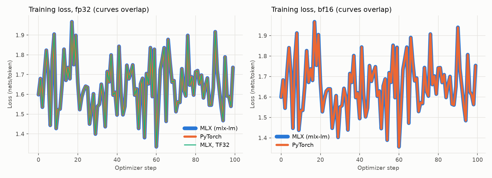
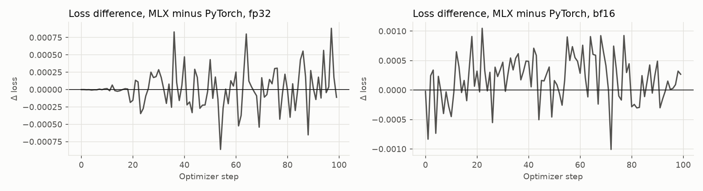

# Full results: macbook-air-m5-32gb

Generated by `scripts/report.py` from this directory. Summary and method: [README.md](../../README.md).

- Apple M5, 32 GB; macOS-27.0.1-arm64-arm-64bit-Mach-O; Python 3.13.5; mlx 0.32.4, mlx_lm 0.32.2, torch 2.14.1, transformers 5.21.0
- 100 optimizer steps × 16,384 tokens = 1.6M training tokens per run; peak LR 2e-05, warmup 5%, cosine to 10%; AdamW β=(0.9, 0.95), eps 1e-08, wd 0.1; clip 1.0

## Speed

| Run | micro-batch × accum | tokens/s, sustained (2nd half) | tokens/s, after warmup | p90 step (s) | first step (s) | thermal level: steps | peak memory (GB) | swap Δ (MB) | wall time (min) |
|---|---|---|---|---|---|---|---|---|---|
| mlx-fp32 | 1 × 16 | **528** | 526 | 35.31 | 26.1 | 0: 3, 1: 1, 2: 96 | 16.8 | -368 | 53 |
| torch-fp32 | 1 × 16 | **399** | 399 | 41.23 | 35.5 | 0: 3, 1: 1, 2: 96 | 19.8 | -40 | 68 |
| mlx-bf16 | 1 × 16 | **1,655** | 1,658 | 9.92 | 8.4 | 0: 12, 1: 5, 2: 83 | 10.1 | +0 | 16 |
| torch-bf16 | 1 × 16 | **673** | 673 | 24.50 | 22.6 | 0: 6, 1: 4, 2: 90 | 14.0 | +0 | 40 |
| mlx-fp32-tf32 | 1 × 16 | **1,049** | 1,062 | 15.92 | 13.8 | 0: 8, 1: 3, 2: 89 | 17.0 | -24 | 25 |

Sustained = median step over the second half of the run, after the machine reaches its thermal steady state; this is the fair comparison on a machine that throttles. After warmup = median step after the first 20 steps. Thermal level: macOS thermal pressure (0 nominal, 1 moderate, 2 heavy) or NVIDIA GPU °C, sampled after each step. Every run starts after the machine returns to baseline.

Peak memory: on macOS the process's physical footprint (CPU + unified GPU memory) as the OS accounts it; on Linux the GPU memory nvidia-smi attributes to the process. Either way, the same measurement for every framework on the machine.

- **fp32: MLX / PyTorch = 1.32× sustained** (1.32× after warmup)
- **bf16: MLX / PyTorch = 2.46× sustained** (2.46× after warmup)
- mlx-fp32-tf32 vs mlx-fp32: 1.99× sustained

## Loss agreement

| Pair | steps | final loss MLX | final loss PyTorch | max per-step Δ loss | mean per-step Δ loss |
|---|---|---|---|---|---|
| fp32 | 100 | 1.7363 | 1.7364 | 0.0009 | 0.0002 |
| bf16 | 100 | 1.7535 | 1.7532 | 0.0010 | 0.0004 |

## Matching check (fp32, untrained model, 2 held-out sequences)

| Check | Value |
|---|---|
| loss_abs_diff | 4.77e-07 |
| grad_norm_rel_diff | 1.49e-06 |
| grad_rel_diff_median | 0.000341 |
| grad_rel_diff_max | 0.00846 |
| grad_rel_diff_max_param | model.layers.25.input_layernorm.weight |
| logits_max_abs_diff | 0.000373 |
| logits_mean_abs_diff | 7.88e-06 |
| argmax_agreement | 1 |

## Memory / micro-batch probe (3 steps each)

| Setup | micro-batch | ok | tokens/s (step 3) | peak memory (GB) | framework-reported (GB) | swap Δ (MB) |
|---|---|---|---|---|---|---|
| mlx-fp32 | 1 | yes | 639 | 16.8 | 15.4 | -352 |
| mlx-fp32 | 2 | yes | 631 | 22.7 | 20.2 | -8 |
| mlx-fp32 | 4 | no | 609 | 26.5 | 24.6 | – |
| torch-fp32 | 1 | yes | 392 | 19.8 | 18.8 | -224 |
| torch-fp32 | 2 | yes | 265 | 30.7 | 29.7 | +2045 |
| mlx-bf16 | 1 | yes | 1,620 | 10.1 | 8.9 | -1057 |
| mlx-bf16 | 2 | yes | 1,556 | 14.4 | 12.6 | -56 |
| mlx-bf16 | 4 | yes | 1,500 | 22.1 | 20.2 | -56 |
| mlx-bf16 | 8 | no | – | – | – | – |
| torch-bf16 | 1 | yes | 603 | 14.0 | 13.6 | -40 |
| torch-bf16 | 2 | yes | 541 | 23.7 | 23.3 | -83 |
| torch-bf16 | 4 | no | – | – | – | – |

Framework-reported memory: MLX = `mx.get_peak_memory()` (true peak of live buffers); PyTorch CUDA = `torch.cuda.max_memory_allocated()` (true peak); PyTorch MPS = `torch.mps.driver_allocated_memory()` at step end (includes its cache, not a true peak).

## Conversion to MLX (bf16)

| Run | save (s) | mlx_lm.convert (s) | load, warm (s) | load, cold (s) | size (GB) |
|---|---|---|---|---|---|
| mlx-fp32 | 0.6 | 2.5 | 0.36 | – | 1.19 |
| torch-fp32 | 0.9 | 1.9 | 0.35 | – | 1.19 |
| mlx-bf16 | 0.4 | 1.8 | 0.36 | – | 1.19 |
| torch-bf16 | 0.7 | 1.7 | 0.36 | – | 1.19 |
| mlx-fp32-tf32 | 0.6 | 3.3 | 0.38 | – | 1.19 |

Torch → MLX transfer check (same checkpoint, fp32, 2 held-out sequences):

| Run | logits max Δ | logits mean Δ | loss, PyTorch fp32 | loss, MLX fp32 | loss, converted MLX bf16 |
|---|---|---|---|---|---|
| torch-fp32 | 0.00055 | 7.7e-06 | 2.2832 | 2.2832 | 2.2843 |
| torch-bf16 | 0.00074 | 8.5e-06 | 2.2943 | 2.2943 | 2.2965 |

## Perplexity (all models evaluated in mlx-lm, bf16)

| Model | arXiv held-out (524,288 tokens) | wikitext-103 test |
|---|---|---|
| base | 5.505 | 14.129 |
| mlx-fp32 | 5.182 | 14.814 |
| torch-fp32 | 5.181 | 14.795 |
| mlx-bf16 | 5.253 | 14.299 |
| torch-bf16 | 5.252 | 14.304 |
| mlx-fp32-tf32 | 5.181 | 14.818 |

