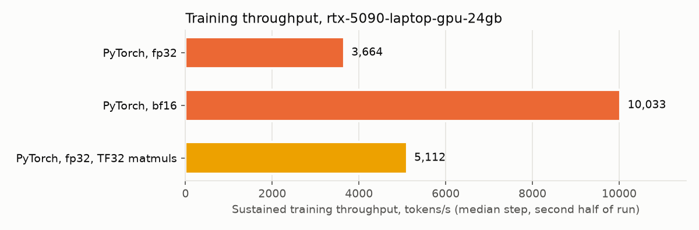
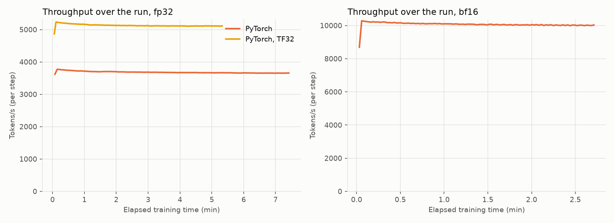
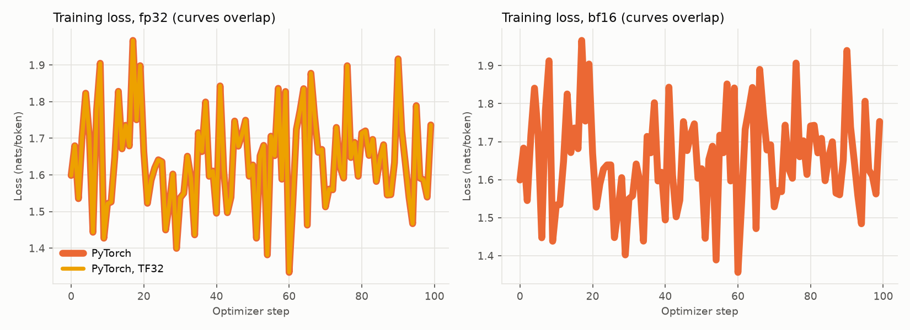
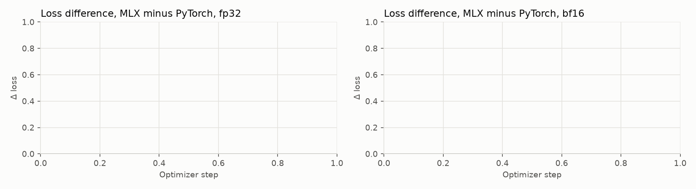

# Full results: rtx-5090-laptop-gpu-24gb

Generated by `scripts/report.py` from this directory. Summary and method: [README.md](../../README.md).

- NVIDIA GeForce RTX 5090 Laptop GPU, 188 GB; Linux-7.2.6-76070206-generic-x86_64-with-glibc2.39; Python 3.13.12; torch 2.14.1+cu130, transformers 5.21.0, cuda 13.0
- 100 optimizer steps × 16,384 tokens = 1.6M training tokens per run; peak LR 2e-05, warmup 5%, cosine to 10%; AdamW β=(0.9, 0.95), eps 1e-08, wd 0.1; clip 1.0

## Speed

| Run | micro-batch × accum | tokens/s, sustained (2nd half) | tokens/s, after warmup | p90 step (s) | first step (s) | thermal level: steps | peak memory (GB) | swap Δ (MB) | wall time (min) |
|---|---|---|---|---|---|---|---|---|---|
| torch-fp32 | 1 × 16 | **3,664** | 3,669 | 4.48 | 4.5 | 51: 1, 52: 1, 54: 2, 56: 1, 57: 2, 58: 1, 59: 1, 60: 2, 61: 1, 62: 1, 63: 3, 64: 2, 65: 3, 66: 7, 67: 3, 68: 7, 69: 11, 70: 20, 71: 15, 72: 11, 73: 4, 74: 1 | 15.4 | +0 | 7 |
| torch-bf16 | 1 × 16 | **10,033** | 10,053 | 1.64 | 1.9 | 54: 1, 55: 1, 56: 3, 58: 3, 59: 2, 60: 2, 61: 6, 62: 3, 63: 1, 64: 6, 65: 4, 66: 5, 67: 6, 68: 10, 69: 17, 70: 16, 71: 14 | 9.6 | +0 | 3 |
| torch-fp32-tf32 | 1 × 16 | **5,112** | 5,116 | 3.21 | 3.4 | 56: 1, 58: 2, 60: 1, 61: 2, 62: 1, 63: 2, 64: 1, 65: 4, 66: 3, 67: 4, 68: 6, 69: 5, 70: 15, 71: 22, 72: 28, 73: 3 | 15.4 | +0 | 5 |

Sustained = median step over the second half of the run, after the machine reaches its thermal steady state; this is the fair comparison on a machine that throttles. After warmup = median step after the first 20 steps. Thermal level: macOS thermal pressure (0 nominal, 1 moderate, 2 heavy) or NVIDIA GPU °C, sampled after each step. Every run starts after the machine returns to baseline.

Peak memory: on macOS the process's physical footprint (CPU + unified GPU memory) as the OS accounts it; on Linux the GPU memory nvidia-smi attributes to the process. Either way, the same measurement for every framework on the machine.

- torch-fp32-tf32 vs torch-fp32: 1.40× sustained

## Loss agreement

| Pair | steps | final loss MLX | final loss PyTorch | max per-step Δ loss | mean per-step Δ loss |
|---|---|---|---|---|---|

